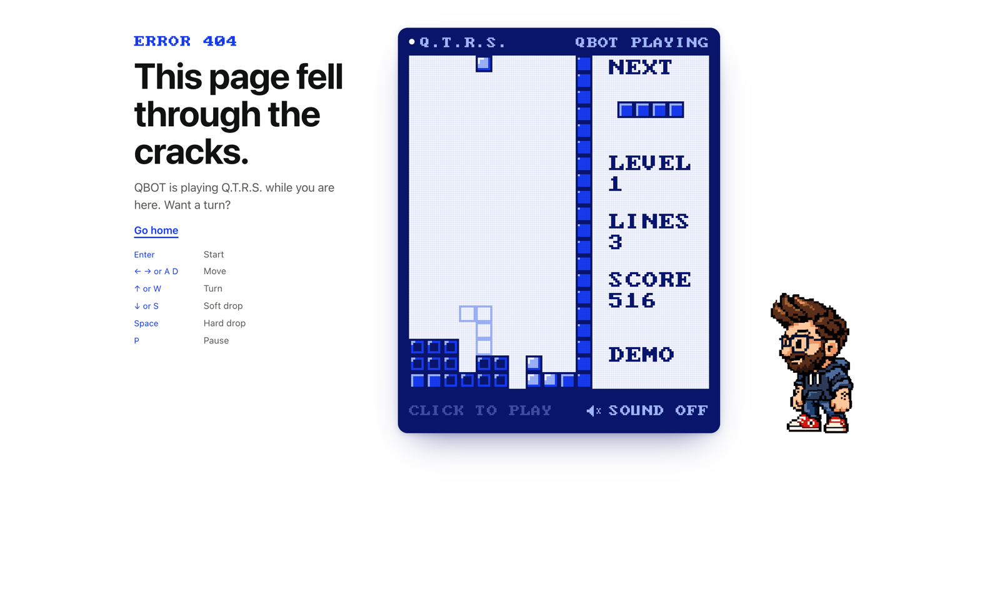
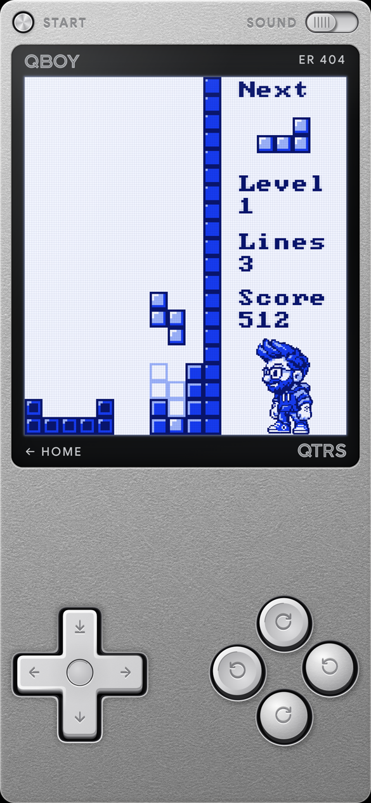

# Q.T.R.S. 404 Page

*Queue, Turn, Rotate, Slam.*

A 404 page you don't mind landing on. **QBOT**, a pixel-art Q, plays Tetris on a blue-and-white handheld. Click, tap, or press Enter and the game is yours, with a leaderboard. On a phone the whole screen becomes the **QBOY** handheld, with on-screen controls.

**Live demo:** https://qmanning.com/labs/qtrs-404-page





## What it does

- **Desktop:** the heading and controls on the left, the handheld in the middle, Action Q beside it. QBOT plays an imperfect, believable game and reacts with bubbles and little animations. Click the screen, press Enter or Space, or hit the button to take over (3, 2, 1, GO!). Leave it alone for about 30 seconds and he takes it back. A ghost piece shows where the piece will land.
- **Phones (820px wide or less):** the QBOY handheld fills the screen: D-pad, two turn directions, START, SOUND and Home. Swipe on the screen works too.
- **Sound:** QBOT's voice and chiptune effects, **off by default**. Nothing audio is requested until the visitor turns it on.
- **High scores:** a top-10 list in the game's own look. Without a backend it keeps scores in the visitor's browser.
- **Error pages:** the same game serves a 404, a 500 with a "Try again" button, or a page of its own.

## Install

It is a folder you drop into a Next.js app (built and tested with Next 15 and React 19, App Router). No UI kit, no Tailwind, no `@/` alias, no `next/font`.

1. Copy `src/` into your project (for example to `src/qtrs`), and `public/qtrs/` into your `public/` folder.
2. `npm i lucide-react` (the button icons).
3. Use it as your `not-found.tsx`:

```tsx
// app/not-found.tsx
import Qtrs404 from "@/qtrs/components/Qtrs404";

export default function NotFound() {
    return <Qtrs404 home="/" />;
}
```

And, for runtime errors, your `error.tsx`:

```tsx
// app/error.tsx
"use client";
import Qtrs404 from "@/qtrs/components/Qtrs404";
import { QTRS_500 } from "@/qtrs/lib/errorCopy";

export default function Error({ reset }: { error: Error; reset: () => void }) {
    return <Qtrs404 home="/" {...QTRS_500} onRetry={reset} />;
}
```

This repo is also a runnable Next.js app: `npm install && npm run dev`. `/` is the game as a page, `/nope` is the 404, `/boom` throws to show the 500.

## Props

| Prop | Type | Default | What it does |
|---|---|---|---|
| `home` | string | `"/"` | Where "Go home" and the QBOY's Home button go |
| `code` | string | `"404"` | The error code. `"qtrs"` is the plain game page; anything else is an error page with the same game. Shown on the QBOY's bezel |
| `title` | string | `"Error 404"` | The small tag above the heading |
| `lines` | `[string, string]` | the 404 copy | The heading and the short paragraph under it |
| `onRetry` | `() => void` | none | When set, a "Try again" button sits beside "Go home" (pass your error boundary's `reset`) |
| `leaderboard` | string or `{ list, submit }` | none | A leaderboard endpoint (see below). Left out, scores stay in `localStorage` |
| `assetBase` | string | `"/qtrs"` | The folder the sprites, fonts, voice and sound effects are served from |
| `musicSrc` | string | none | An optional looping music track URL. There is none by default |

### Leaderboard endpoint

Pass one URL, or `{ list, submit }` if they are two:

```
GET  {list}?limit=10   ->  { "leaderboard": [{ "initials": "ABC", "score": 1200 }, ...] }   best first
POST {submit}  { "initials": "ABC", "score": 1200, "level": 3, "lines": 21 }   ->  any 2xx
```

A score is offered a name prompt only if it makes the top 10. Validate and rate-limit the POST on your side: anything the browser sends can be faked.

## Files and weight

```
src/components/Qtrs404.tsx          the game, the page and the QBOY (client component)
src/components/Qtrs404.module.css
src/components/ScoreSubmissionModal.tsx (+ .module.css)
src/lib/gameEngine.ts               the whole game, no React
src/lib/autoplay.ts                 QBOT, the imperfect player
src/lib/swipeDetection.ts, scores.ts, errorMessages.ts, errorCopy.ts
src/manifests/                      sprite, voice and sound-effect tables
public/qtrs/                        about 690 KB: sprites and QBOY art 311 KB,
                                    voice 274 KB, sound effects 29 KB, fonts 77 KB
```

Voice and effects are fetched only after sound is turned on. Google Sans is fetched only when the QBOY shows. To skip sound entirely, delete `public/qtrs/voice` and `public/qtrs/sfx`: the game plays silently.

## How it works

- `gameEngine.ts` is the game: board, tetrominoes, rotation with wall kicks, line clears, scoring, level speed. It has no React in it.
- `autoplay.ts` is QBOT: it scores every placement, then plays like a person (noise, blunders, second thoughts).
- `Qtrs404.tsx` draws a 144 x 160 pixel canvas at a whole-number scale, drives QBOT and the visitor's game, and renders the desktop page or the QBOY.

## Scripts

`npm run typecheck`, `npm run lint`, `npm test` (the autoplay and engine tests), `npm run build`.

## Credits and licences

- **Code:** MIT (see `LICENSE`). Built on [Basic Tetris HTML and JavaScript Game](https://gist.github.com/straker/3c98304f8a6a9e20f2f8e1e1b86b0bc4) by Steven Lambert (MIT), ported to TypeScript and extended. If you build on this, please carry the credit forward.
- **Sprites:** Q's pixel art was made with [PixelLab](https://www.pixellab.ai).
- **Icons:** [Lucide](https://lucide.dev) (ISC), through `lucide-react`.
- **Google Sans:** the QBOY's bezel type, SIL Open Font License 1.1 (`public/qtrs/fonts/Google-Sans-OFL.txt`).
- **IBM CGA pixel font:** `Web437_IBM_CGA.woff`, from The Ultimate Oldschool PC Font Pack by VileR ([int10h.org](https://int10h.org/oldschool-pc-fonts/)), licensed CC BY-SA 4.0 (`public/qtrs/fonts/IBM-CGA-LICENSE-CC-BY-SA-4.0.txt`). That font file stays under its own licence; it does not change the licence of the code.
- **Voice clips:** Q's own voice, recorded and processed by Q. Sound effects are synthesised, no samples.
- **Artwork:** the QBOY plastic texture and the QBOY and Q.T.R.S. wordmarks are Q's own.

## License

MIT, apart from the fonts and sprites credited above.

---

Made by [Q Manning](https://qmanning.com) · [Source on GitHub](https://github.com/qmanning/qtrs-404-page) · [See it live in the Labs](https://qmanning.com/labs/qtrs-404-page)
